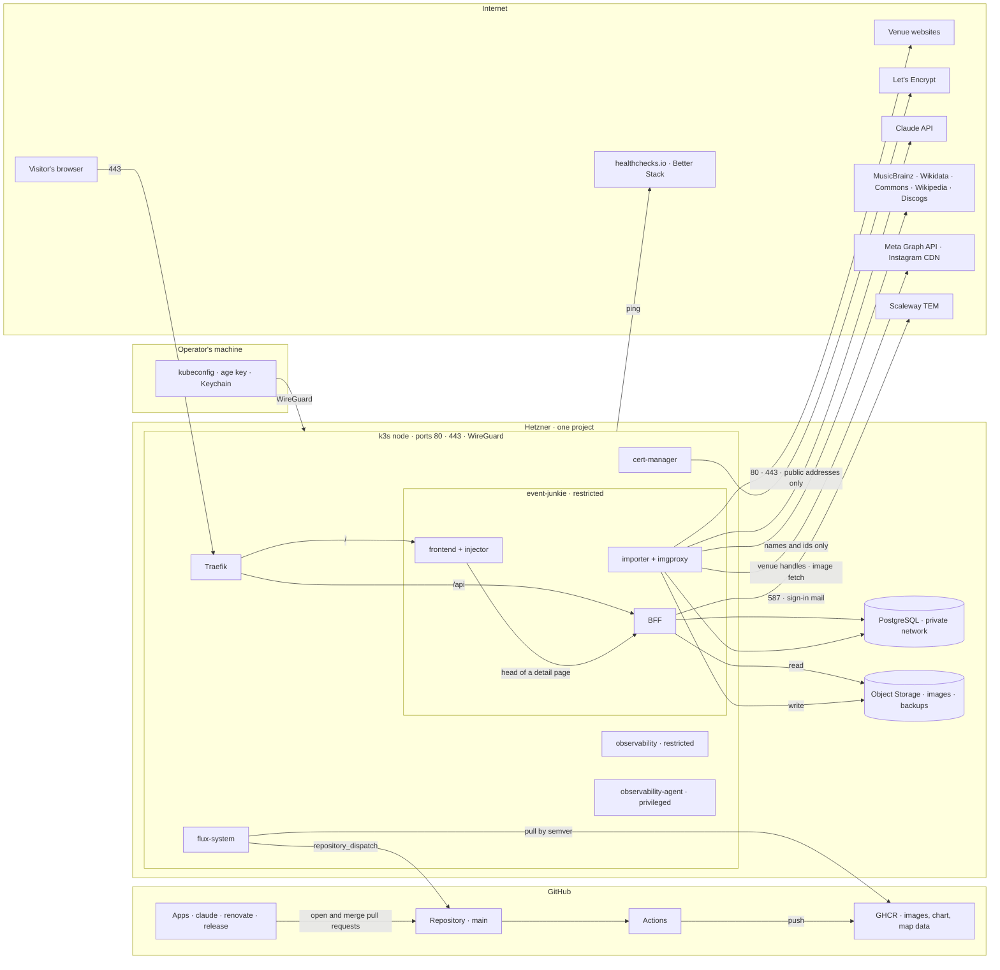

# Threat model

What an attacker can reach, what can go wrong at each boundary, and what stops it. The model follows the four questions of the
[OWASP Threat Modeling Cheat Sheet](https://cheatsheetseries.owasp.org/cheatsheets/Threat_Modeling_Cheat_Sheet.html) and uses STRIDE to name each threat.
Every _mitigated_ row names the file that does the work. A reader can check each row against the tree.

**Last reviewed: 2026-09-14.** §4 says when the model must be read again.

## The short version

- **One inbound path.** Ports 80 and 443 on one node, through Traefik, to two routes: `/` and `/api`. Everything else is unroutable by name
  ([ADR-023](../adr/ADR-023_OPERATOR_AUTHENTICATION.md)).
- **Two ways to sign in, and one session cookie.** A visitor can sign in with a one-time link ([ADR-053](../adr/ADR-053_VISITORS_SIGN_IN_BY_EMAIL_LINK_IN_THE_BFF.md))
  or with a passkey (#3888).
  Spring Security in the BFF guards `/api/auth/**` and `/api/me/**` only. The rest of the API reads public data, and the importer writes it. B13 has the rows.
- **The strongest controls are network controls.** Default-deny NetworkPolicies, a firewall with two public ports, Pod Security `restricted`, and
  staging on the WireGuard tunnel only.
- **The strongest credential in the system is write access to `main`.** What lands there is what the cluster runs
  ([ADR-016](../adr/ADR-016_GITOPS_DELIVERY.md)). Three GitHub Apps can open a pull request there. A required check refuses the unlisted one (#1424).
- **No open threat is ranked in §3 today.** The last two — an unsigned chart on production (#1425) and a `privileged` namespace (#709) — are closed. The
  accepted rows there are the trade-offs still standing.

## 1 · What we are working on

### Trust zones

### Assets

| Asset                          | Why it matters                                                                                                                                                                                                                                                                                                                       | Where it is                                                                                        |
| ------------------------------ | ------------------------------------------------------------------------------------------------------------------------------------------------------------------------------------------------------------------------------------------------------------------------------------------------------------------------------------ | -------------------------------------------------------------------------------------------------- |
| `main`                         | What lands there is what runs on the cluster, after `release.yml` and Flux                                                                                                                                                                                                                                                           | GitHub, ruleset `main`                                                                             |
| The published chart and images | Flux pulls them by semver range, anonymously, and runs what it gets                                                                                                                                                                                                                                                                  | `ghcr.io/enorm-labs/`                                                                              |
| The map data                   | Every tile, glyph and icon of the map. The tiles come from a Protomaps daily build, which publishes no digest to check                                                                                                                                                                                                               | `ghcr.io/enorm-labs/event-junkie-map-assets`, pinned by digest in `events-frontend/Dockerfile`     |
| The database                   | Every event, venue and artist. A `--full` re-seed rebuilds it from the venues, [RESTORE_RUNBOOK.md](../ops/RESTORE_RUNBOOK.md) restores it                                                                                                                                                                                           | PostgreSQL on the private network, backups in Object Storage                                       |
| The fifteen cluster secrets    | Each has its own exposure cost, listed in [SECRETS.md](../ops/SECRETS.md)                                                                                                                                                                                                                                                            | Per cluster. `events-db` in git under SOPS, the rest hand-made                                     |
| The Hetzner token              | Read and write on every server, volume and firewall in the project                                                                                                                                                                                                                                                                   | Staging's `cert-manager` namespace, the operator's Keychain                                        |
| `github-dispatch`              | `contents: write` on this repository. The one secret that cannot be regenerated                                                                                                                                                                                                                                                      | `flux-system` on each cluster                                                                      |
| The domain and its certificate | `event-junkie.de`, HSTS pinned for a year                                                                                                                                                                                                                                                                                            | Hetzner DNS, cert-manager                                                                          |
| Availability                   | One node and one Traefik pod. Two BFF and two frontend replicas on production. Better Stack notices in about six minutes                                                                                                                                                                                                             | [ADR-021](../adr/ADR-021_PUBLIC_SITE_MONITORING.md)                                                |
| Visitor privacy                | No third-party script. An account holds an e-mail address. A visitor who opens the sign-in page stores `XSRF-TOKEN`. A visitor who signs in also stores `__Host-ej_session`. Any other visitor stores no cookie. The access log carries no client address and expires after 14 days. The position for "near me" stays in the browser | `RequestLoggingFilter.kt`, `openobserve.yaml`, `useLocation.ts`, `AccountSecurityConfiguration.kt` |

### Inbound entry points

| Entry                                                                | Who may reach it                                 | Where it is decided                                                                        |
| -------------------------------------------------------------------- | ------------------------------------------------ | ------------------------------------------------------------------------------------------ |
| 80 and 443 on the k3s node                                           | Everyone, production only                        | `infra/modules/environment/firewall.tf`, `public_web = false` on staging                   |
| WireGuard UDP                                                        | Everyone, but only listed peer keys              | `firewall.tf`, `wireguard.sh`                                                              |
| 22 and 6443                                                          | Nobody. `admin_cidrs = []` on both               | `firewall.tf`, both `terraform.tfvars`                                                     |
| `/` and `/api` through Traefik                                       | Everyone                                         | `deploy/charts/event-junkie/templates/ingress.yaml`, enforced by `tests/ingress_test.yaml` |
| `/api/admin/**`, `/actuator/**`, the importer, both management ports | Nobody from outside. `kubectl port-forward` only | Same Ingress. ADR-023 names this the control                                               |
| PostgreSQL 5432                                                      | The private subnet and the pod CIDR, with SCRAM  | `postgres.sh`, the `postgres` firewall has no inbound rule                                 |
| OpenObserve, signal-cli                                              | The tunnel                                       | No Ingress in `deploy/clusters/`                                                           |

### Outbound connections

Every namespace under the chart starts from default deny. Each arrow below is a named NetworkPolicy in `templates/networkpolicy.yaml`.

| From         | To                                                                                                                                 | Bound by                                                                                                                                                           |
| ------------ | ---------------------------------------------------------------------------------------------------------------------------------- | ------------------------------------------------------------------------------------------------------------------------------------------------------------------ |
| importer     | Any public address, TCP 80 and 443                                                                                                 | `allow-scraping`. Excepts the three RFC 1918 ranges and `169.254/16`. Pods have no IPv6 address                                                                    |
| importer     | PostgreSQL                                                                                                                         | `allow-database`, one address                                                                                                                                      |
| importer     | Object Storage, 443                                                                                                                | `allow-scraping` covers it, since the bucket is a public address                                                                                                   |
| importer     | MusicBrainz, Wikidata, Commons, Wikipedia                                                                                          | `allow-scraping` covers them, since they are public addresses. B5 lists what is sent                                                                               |
| importer     | Discogs                                                                                                                            | `allow-scraping` covers it, since it is a public address. B5 lists what is sent                                                                                    |
| importer     | `graph.facebook.com` and Instagram's CDN, for the Instagram drafts                                                                 | `allow-scraping` covers them, since they are public addresses. B11 lists what is sent                                                                              |
| importer     | Enrichment sources, such as promoter and fan sites ([ADR-043](../adr/ADR-043_ONE_MAIN_SOURCE_PER_VENUE_AND_ENRICHMENT_SOURCES.md)) | `allow-scraping`. The scraper client applies `RobotsTxtFilter.kt` and `PerHostThrottlingFilter.kt`, as for a venue. B4 lists what a source can write               |
| importer     | The sites of venues with no importer, once a month (`venuecheck/`)                                                                 | `allow-scraping`. `VenueSiteProber.kt` uses the scraper client, so the robots and throttling filters apply. `ForbiddenHosts.kt` skips some hosts, B4               |
| BFF          | PostgreSQL, Object Storage on 443                                                                                                  | `allow-database` and `allow-object-storage`. The BFF never reaches a venue                                                                                         |
| BFF          | The browsers' push services on 443: Google, Mozilla, Apple, Microsoft                                                              | `allow-push`, rendered only with the push Secret. The internet minus the private ranges. `PushEndpoints.kt` refuses any other host, B12                            |
| BFF          | Scaleway TEM, TCP 587, for the sign-in mail ([ADR-054](../adr/ADR-054_TRANSACTIONAL_MAIL_THROUGH_SCALEWAY_TEM.md))                 | `allow-mail`, rendered only while `mail.existingSecret` is set. Any public address, on port 587 only. `application.yaml` requires STARTTLS. B13 lists what is sent |
| frontend     | The BFF service port                                                                                                               | `allow-frontend-to-bff`, for the injector sidecar                                                                                                                  |
| cert-manager | Let's Encrypt, the Hetzner API on staging                                                                                          | `cert-manager-netpol.yaml` per cluster                                                                                                                             |
| flux-system  | GHCR, `github.com`                                                                                                                 | Flux's own namespace, outside the chart                                                                                                                            |
| The node     | healthchecks.io, Object Storage for backups                                                                                        | `backups.sh`. Ping URLs live only on the node                                                                                                                      |

## 2 · What can go wrong

STRIDE letters: **S**poofing, **T**ampering, **R**epudiation, **I**nformation disclosure, **D**enial of service, **E**levation of privilege. Status
is one of three words. _Mitigated_ names the file or issue. _Accepted_ gives the reason. _Open_ names the issue that tracks it.

Likelihood and impact are each `low`, `medium` or `high`, judged for this system and not in general.

### B1 · Internet → Traefik

| Threat                                   | STRIDE | Likelihood | Impact | Status                                                                                                                                                                                      |
| ---------------------------------------- | ------ | ---------- | ------ | ------------------------------------------------------------------------------------------------------------------------------------------------------------------------------------------- |
| A request flood exhausts the BFF pods    | D      | medium     | medium | Mitigated. `rate-limit-middleware.yaml`: 100 in flight, 50/s per source, burst 250. Real source addresses since #1013. `ej-rate-limit-storm` mails `alerts@` when the limits reject (#1455) |
| A scanner enumerates paths, unseen       | I      | high       | low    | Mitigated. `ej-4xx-flood` mails `alerts@` when client errors pass 5 a second for 30 minutes (#1455)                                                                                         |
| Plaintext first request, TLS stripped    | T, I   | low        | low    | Mitigated. HSTS for one year, `security-headers-middleware.yaml`. The redirect host is not pinned, on purpose                                                                               |
| A certificate expires unnoticed          | D      | low        | high   | Mitigated. cert-manager renews. `site-probe.yml` and Better Stack fail on an untrusted certificate                                                                                          |
| A port other than 80 and 443 answers     | E      | low        | high   | Mitigated. `firewall.tf`. Nothing tests it from outside. `dast.yml` talks to 443 only, so a port probe stays open                                                                           |
| The node's SSH accepts a password        | S      | low        | high   | Mitigated. `harden.sh`: `PasswordAuthentication no`, `PermitRootLogin no`, and port 22 is closed by the firewall                                                                            |
| Traefik or nginx carries a published CVE | E      | medium     | high   | Mitigated. Renovate and Dependabot propose, Trivy blocks a publish, `image-scan-scheduled.yml` rescans what is deployed                                                                     |

### B2 · Traefik → frontend, Traefik → BFF

| Threat                                                         | STRIDE | Likelihood | Impact | Status                                                                                                                                                                                                                  |
| -------------------------------------------------------------- | ------ | ---------- | ------ | ----------------------------------------------------------------------------------------------------------------------------------------------------------------------------------------------------------------------- |
| Scraped text carries a script and the page renders it          | T      | medium     | medium | Mitigated. Vue escapes by default and the tree has no `v-html`. The injector escapes every value. CSP allows one script hash (#854)                                                                                     |
| A venue title with `$'` or `` $` `` corrupts the injected head | T, D   | low        | low    | Mitigated. `rewrite.ts` replaces through a function, so `$` patterns are inserted as they are (#1426). `rewrite.spec.ts` asserts it                                                                                     |
| An expensive query holds a connection                          | D      | medium     | medium | Mitigated. Page size ≤ 100 (`application.yaml`), calendar range ≤ `MAX_CALENDAR_DAYS` (`EventService.kt`), unknown parameters are a 400                                                                                 |
| A 500 leaks a stack trace or a query                           | I      | low        | low    | Mitigated. `ProblemDetailErrorHandler.kt` answers with a `ProblemDetail`. #1421 tests the body                                                                                                                          |
| A 400 names the controller method and its classes              | I      | medium     | low    | Mitigated. `GlobalExceptionHandler.kt` answers a parameter that does not convert with its name, its value and the expected type. `InvalidQueryParameterTest.kt` tests the body. ZAP rule 90022 fails the k3d API scan   |
| Another site's script reads the API                            | I      | low        | low    | Accepted. The data is public. CORS allows `GET` for the listed origins only (`WebFluxConfiguration.kt`), and is not an access control                                                                                   |
| A script on the page reads the visitor's position              | I      | low        | medium | Mitigated. `Permissions-Policy` allows `geolocation=(self)` only (`values.yaml`). The browser asks the visitor first. The CSP allows one script hash. The position goes into no request ([LEGAL.md](../LEGAL.md) §7.4a) |
| A path under `/api/images` reaches an arbitrary object         | I      | low        | low    | Mitigated. `CachedImageController.kt` resolves the key from the database, never from the path                                                                                                                           |
| The admin API or Actuator becomes routable                     | E      | low        | high   | Mitigated. `tests/ingress_test.yaml` fails the build. ADR-023 makes an admin surface without a middleware a breach of the decision                                                                                      |
| A crawler or a scraper copies the whole dataset                | I      | high       | low    | Accepted. The data is public and aggregated from public pages. #268 records why the API cannot be made frontend-only                                                                                                    |

### B3 · BFF and importer → PostgreSQL

| Threat                                            | STRIDE | Likelihood | Impact | Status                                                                                                                                      |
| ------------------------------------------------- | ------ | ---------- | ------ | ------------------------------------------------------------------------------------------------------------------------------------------- |
| SQL injection through a query parameter           | T, I   | low        | high   | Mitigated. R2DBC binds every parameter. `EventSearchRepository.kt` whitelists sort columns. #1421's API scan fuzzes each parameter          |
| The database answers on a public address          | I, E   | low        | high   | Mitigated. `listen_addresses` is `localhost` and the private address. `pg_hba.conf` allows the subnet and the pod CIDR                      |
| The `events` password leaks from git              | I      | low        | low    | Accepted. SOPS with age. SECRETS.md records that the password is useless without network access                                             |
| A backup is lost or restored wrong                | T, D   | low        | high   | Mitigated. wal-g to Object Storage, a quarterly restore drill (`restore-drill-reminder.yml`), [BACKUPS.md](../ops/BACKUPS.md)               |
| A backup is read by a key that reaches its bucket | I      | low        | high   | Accepted. wal-g compresses the base backups and the WAL and does not encrypt them (`backups.sh`). Any key of the project can read them, B10 |

### B4 · Importer → venue, promoter and fan websites

The importer is the one workload that talks to the open internet. Everything it reads is attacker-controlled text. It reads a venue's main source and,
under ADR-043, enrichment sources. Once a month it also requests the sites of venues with no importer, and reads only the status.

| Threat                                                              | STRIDE | Likelihood | Impact | Status                                                                                                                                                                                                                                                                                                                                                                                                                                                                     |
| ------------------------------------------------------------------- | ------ | ---------- | ------ | -------------------------------------------------------------------------------------------------------------------------------------------------------------------------------------------------------------------------------------------------------------------------------------------------------------------------------------------------------------------------------------------------------------------------------------------------------------------------- |
| A venue page points a fetch at a private address (SSRF)             | I, E   | medium     | high   | Mitigated at the packet level. `allow-scraping` excepts the RFC 1918 ranges and `169.254/16`. A redirect or DNS rebinding hits the same rule                                                                                                                                                                                                                                                                                                                               |
| A fetch reaches the node's own public address                       | E      | low        | low    | Accepted. Ports 80 and 443 there are the public site. Nothing else answers                                                                                                                                                                                                                                                                                                                                                                                                 |
| An oversized or hostile image exhausts the importer                 | D      | medium     | low    | Mitigated. `ImageFetcher.kt` rejects by declared and actual size, sniffs the type, and reads the header before decoding                                                                                                                                                                                                                                                                                                                                                    |
| Bad data poisons the dataset                                        | T      | medium     | low    | Accepted. Two kinds of source can write. A venue can publish anything about itself. An approved enrichment source can fill fields on that venue's events (ADR-043). `EventEnrichmentService.kt` holds it to three limits: it fills empty fields only, it never creates or removes an event, and it never changes a value of the main source. No enrichment source is live until #3002 reviews the first. `/plausibility-check` and `/data-quality-audit` read for bad data |
| Our scraping harms a venue                                          | D      | low        | medium | Mitigated. `PerHostThrottlingFilter.kt`, `RobotsTxtFilter.kt`, one User-Agent ([ADR-007](../adr/ADR-007_WEB_SCRAPING_STRATEGY.md))                                                                                                                                                                                                                                                                                                                                         |
| The monthly site check requests a host that forbids scripted access | D      | low        | low    | Mitigated. `ForbiddenHosts.kt` never contacts a host whose terms forbid it, such as `ra.co` or Facebook. It also skips a host it cannot read. `VenueSiteProber.kt` uses the scraper client, so `RobotsTxtFilter.kt` and `PerHostThrottlingFilter.kt` apply                                                                                                                                                                                                                 |
| The monthly site check stops, unseen                                | D      | low        | low    | Mitigated. `ej-venue-site-check-stale` mails `alerts@` when no pass finished in 33 days (#3147)                                                                                                                                                                                                                                                                                                                                                                            |

### B5 · Importer → Claude API, MusicBrainz, Wikimedia and Discogs

On a scheduled tick the importer looks up the billed artists in MusicBrainz ([ADR-031](../adr/ADR-031_ARTIST_IDENTITY_HUB.md)). For an exact match it
reads a picture from Wikidata and Commons, and an ensemble's lead from Wikipedia. All four are on by default (`app.musicbrainz.enabled`,
`app.wikimedia.enabled`). Anyone can edit what they return. For an artist MusicBrainz does not know, the importer searches Discogs
([ADR-035](../adr/ADR-035_DISCOGS_SECOND_ARTIST_INDEX.md)). The chart ships that lookup off (`importer.discogs.enabled`).

| Threat                                                                                | STRIDE | Likelihood | Impact | Status                                                                                                                                                                                                               |
| ------------------------------------------------------------------------------------- | ------ | ---------- | ------ | -------------------------------------------------------------------------------------------------------------------------------------------------------------------------------------------------------------------- |
| Venue text instructs the model                                                        | T      | medium     | low    | Accepted. A translation is stored as text and rendered escaped. A suggestion or an Instagram draft (B11) changes nothing until a person accepts it                                                                   |
| The key leaks and someone spends against the workspace                                | I      | low        | low    | Mitigated. Hand-made, never in git, a spend cap on the workspace. SECRETS.md § `event-junkie-anthropic`                                                                                                              |
| The Discogs consumer credentials leak and someone searches as our application         | I      | low        | low    | Mitigated. Hand-made, never in git, never logged: `DiscogsProperties.toString` hides them and `DiscogsClientTest` asserts it. SECRETS.md § `event-junkie-discogs`                                                    |
| A Discogs entry gives a wrong act the same name, and its link reaches an artist page  | T      | medium     | low    | Accepted. Only a single exact title match with a release in the last 15 years is stored, only as a link. A hand review of 40 links precedes production (#2054)                                                       |
| An edited MusicBrainz or Wikipedia entry puts false or hostile text on an artist page | T      | medium     | low    | Mitigated. Only an exact match is enriched. The text is stored as text and rendered escaped, as in B2. `WikipediaLead.kt` refuses a lead with birth data or under 80 characters. Each lead keeps its CC BY-SA credit |
| A Commons picture carries a licence we may not use                                    | T      | low        | medium | Mitigated. `CommonsLicences` in `CommonsImage.kt` maps known templates to SPDX and refuses any other. The picture, author, licence and source page are stored together or not at all                                 |
| A Commons picture URL points a fetch somewhere hostile                                | I, D   | low        | low    | Mitigated. The picture goes through the same image cache as a venue image, so B4's `ImageFetcher.kt` and `allow-scraping` apply                                                                                      |
| A lookup sends more than a name                                                       | I      | low        | low    | Mitigated. Only a stage name, a MusicBrainz id, a Wikidata id and article titles leave the cluster. `application.yaml`, [LEGAL.md](../LEGAL.md) §7.3a                                                                |
| MusicBrainz or Wikimedia fails for days, unseen                                       | D      | medium     | low    | Mitigated. Polite delays and retries, and a pass stops after three failures in a row. `ej-musicbrainz-failing` and `ej-musicbrainz-backlog-stuck` mail `alerts@` (#1900)                                             |
| Discogs fails for days, unseen                                                        | D      | medium     | low    | Mitigated. The same retries and three-failure stop. `ej-discogs-failing` and `ej-discogs-backlog-stuck` mail `alerts@` (#2043)                                                                                       |
| The artist lookup tick stops, unseen                                                  | D      | low        | low    | Mitigated. `ej-artist-lookup-tick-stale` mails `alerts@` when no tick finished in an hour, backlog or not (#2059)                                                                                                    |

### B6 · GitHub Actions → GHCR → Flux → cluster

| Threat                                                | STRIDE | Likelihood | Impact | Status                                                                                                                                                                                               |
| ----------------------------------------------------- | ------ | ---------- | ------ | ---------------------------------------------------------------------------------------------------------------------------------------------------------------------------------------------------- |
| A pull request from a fork runs with secrets          | E      | low        | high   | Mitigated. `pull_request` triggers, `persist-credentials: false`, zizmor in `validate-workflows.yml`. The two `pull_request_target` workflows check out nothing                                      |
| A bot branch runs a hostile install script            | E      | low        | medium | Mitigated. `fix-notices-on-bot-prs.yml` mints the App token only at the push step, after `npm ci`                                                                                                    |
| A dependency ships malware                            | T      | medium     | high   | Mitigated in part. Dependency review on each PR, Dependency-Check nightly, Trivy on each image. Nothing checks a package's provenance                                                                |
| A chart or image in GHCR is replaced and Flux runs it | T, E   | low        | high   | Mitigated. `release.yml` signs the chart and its four images, keyless, on the digest. Every cluster's `spec.verify` matches the workflow's identity (#1425)                                          |
| A tag on GHCR is repointed after the chart verified   | T, E   | low        | high   | Mitigated. The chart names each image `repo:tag@sha256:…`, stamped by `release.yml` from its own push; the node pulls the digest (#1473)                                                             |
| The map-assets image in GHCR is replaced              | T      | low        | low    | Accepted. `publish-map-assets.yml` pushes it by hand, with no signature and no attestation. The frontend Dockerfile copies it by digest, so a new image changes the site only through a pull request |
| A Protomaps build carries hostile tiles               | T      | low        | low    | Accepted. `scripts/map-assets.sh` checks `go-pmtiles` and `basemaps-assets` by SHA-256. Protomaps publishes no digest for the tiles, so TLS and the review of the digest change are the only checks  |
| A chart fails verification and nobody hears of it     | R      | low        | medium | Mitigated. The `source-failure` Alert sends each OCIRepository error to `flux-source-failure.yml`. It goes red unless the chart verifies 60 s later (#2031)                                          |
| A commit reaches `main` without a review              | T      | low        | high   | Mitigated. `merge-gate.yml`, a required check on `pull_request_target`, fails an unlisted App's pull request until a person approves its head (#1424)                                                |
| A tag or an action is unpinned                        | T      | low        | medium | Mitigated. Every action is pinned by SHA, every tool by version. zizmor and Dependabot keep it so                                                                                                    |

### B7 · Operator → cluster

| Threat                                               | STRIDE | Likelihood | Impact | Status                                                                                                                      |
| ---------------------------------------------------- | ------ | ---------- | ------ | --------------------------------------------------------------------------------------------------------------------------- |
| A stolen laptop holds the kubeconfig and the age key | E      | low        | high   | Accepted. One operator, and the tunnel needs the WireGuard private key too. [SECRETS.md](../ops/SECRETS.md) covers rotation |
| The Kubernetes API answers on the internet           | E      | low        | high   | Mitigated. 6443 is closed. Break-glass opens it for `admin_cidrs` only, by a `tofu apply` the operator runs by hand         |
| An action on the cluster cannot be attributed        | R      | low        | low    | Accepted. One operator. Flux writes every reconcile to the GitHub Deployments tab (#565)                                    |

### B8 · Cluster → GitHub and alerting

| Threat                                                        | STRIDE | Likelihood | Impact | Status                                                                                                                                                                             |
| ------------------------------------------------------------- | ------ | ---------- | ------ | ---------------------------------------------------------------------------------------------------------------------------------------------------------------------------------- |
| A node compromise yields `github-dispatch`, `contents: write` | E      | low        | high   | Accepted. `repository_dispatch` needs that scope. The token is hand-made, per cluster, and the ruleset still requires a pull request                                               |
| A node compromise on staging yields the Hetzner token         | E      | low        | high   | Accepted. DNS-01 needs it and Hetzner tokens are project-wide. `infra/AGENTS.md` records the choice. Staging is tunnel-only                                                        |
| Alerting dies with the node it watches                        | D      | low        | medium | Mitigated. healthchecks.io and Better Stack run outside. Silence is the alarm ([HEALTHCHECKS.md](../ops/HEALTHCHECKS.md))                                                          |
| A ping URL leaks and silences an alarm                        | S      | low        | medium | Mitigated. Ping URLs live on the node only, never in git                                                                                                                           |
| An in-cluster rule fires and nobody is told                   | D      | low        | medium | Mitigated. Every rule in `deploy/alerts/alerts.json` mails `alerts@` and writes a row in `alert_history`. `apply.sh --diff` reports a missing mail destination or recipient (#877) |

### B9 · Agent workflows → repository

The `agent-*.yml` workflows run Claude with a shell: `agent-comments`, `agent-docs`, `agent-owasp`, `agent-plausibility`, `agent-refactor` and
`agent-security`. The action replaces `GITHUB_TOKEN` in the process with the `claude` App's installation token.
That App holds `contents`, `pull_requests`, `workflows` and `actions` at `write`. `agent-owasp.yml` and `agent-plausibility.yml` carry a second
job, `notify`, with `issues: write` (#1499). The agent never runs in that job.

| Threat                                                                   | STRIDE | Likelihood | Impact | Status                                                                                                                                                                                                                      |
| ------------------------------------------------------------------------ | ------ | ---------- | ------ | --------------------------------------------------------------------------------------------------------------------------------------------------------------------------------------------------------------------------- |
| A venue page instructs the plausibility agent, which holds a write token | E      | medium     | medium | Mitigated. The token can push a branch and open a pull request. `Merge gate` fails it until the operator reads it and approves the head (#1424)                                                                             |
| The same token pushes onto a person's open branch with auto-merge armed  | T      | low        | high   | Accepted. A required check cannot see who pushed. The window is one armed pull request at a time, and the push shows in its commit list                                                                                     |
| An agent dismisses a security alert                                      | T      | low        | medium | Mitigated. `agent-security.yml` grants `security-events: read` and `--unattended` files nothing                                                                                                                             |
| An agent commits as `GITHUB_TOKEN` and no check runs                     | D      | low        | low    | Mitigated. No `github_token:` input, on purpose. `agent-security.yml` header                                                                                                                                                |
| The Claude OAuth token leaks from a run                                  | I      | low        | medium | Mitigated. A repository secret, masked in logs, revocable in one click                                                                                                                                                      |
| An agent's report reaches the tracker through a job with a write token   | T      | low        | low    | Mitigated. `issues: write` is on the `notify` job only; the agent's shell holds its own job's token. `report-to-issue` passes every input by `env` and reads the report from disk, so no report text becomes script (#1499) |

### B10 · Object Storage and imgproxy → visitors

| Threat                                      | STRIDE | Likelihood | Impact | Status                                                                                                                                                                  |
| ------------------------------------------- | ------ | ---------- | ------ | ----------------------------------------------------------------------------------------------------------------------------------------------------------------------- |
| imgproxy fetches an arbitrary URL           | I, E   | low        | medium | Mitigated. It binds to localhost in the importer pod, `IMGPROXY_ALLOWED_SOURCES` lists the origins, and every URL is signed                                             |
| The images key reaches the backups bucket   | T, I   | low        | high   | Accepted. A Hetzner key reads and writes every bucket of the project until a bucket policy narrows it. This repository applies none. SECRETS.md § `event-junkie-images` |
| A hostile image reaches a visitor's browser | T      | low        | low    | Mitigated. Every derivative is re-encoded by imgproxy at import time ([ADR-020](../adr/ADR-020_IMAGE_PROCESSING.md))                                                    |

### B11 · Importer → Meta Graph API and Instagram's CDN

Once a day the importer asks Business Discovery for the recent posts of each venue on its Instagram list
([ADR-048](../adr/ADR-048_INSTAGRAM_POSTS_THROUGH_BUSINESS_DISCOVERY.md)). It sends a venue's handle and our Page token to `graph.facebook.com`. It
fetches each post's images from Instagram's CDN, and the model reads the caption and the images
([ADR-049](../adr/ADR-049_INSTAGRAM_DRAFTS_READ_THE_POST_IMAGES.md)). The result is a draft for a person to review. The chart ships the pass off
(`importer.instagram.enabled`), and production turns it on.

| Threat                                                                | STRIDE | Likelihood | Impact | Status                                                                                                                                                                                                                                                                                                                                                                             |
| --------------------------------------------------------------------- | ------ | ---------- | ------ | ---------------------------------------------------------------------------------------------------------------------------------------------------------------------------------------------------------------------------------------------------------------------------------------------------------------------------------------------------------------------------------- |
| The Page token leaks and someone reads public accounts as our app     | I      | low        | low    | Mitigated. Hand-made, never in git. It gives no data of ours and no write permission, only Meta's rate limit. SECRETS.md § `event-junkie-instagram`                                                                                                                                                                                                                                |
| The token expires or loses a permission, and no venue is read, unseen | D      | medium     | low    | Mitigated. Meta's codes 10, 200 and 190 stop the pass, and `ej-instagram-access-refused` mails `alerts@` (#3366)                                                                                                                                                                                                                                                                   |
| An image URL in a Graph answer points the fetch somewhere hostile     | I, D   | low        | low    | Mitigated. `InstagramImageFetcher.kt` fetches only an `https` URL on `cdninstagram.com` or `fbcdn.net`, and only a JPEG, PNG or WebP of at most 5 MB. `InstagramHttpClientConfig.kt` follows no redirect, so the host check holds. The bytes stay in memory for one model call and are not stored                                                                                  |
| A caption or a flyer instructs the model and plants an event          | T      | medium     | low    | Mitigated. `AnthropicPostExtractor.kt` sends the caption as a JSON document, and the system prompt calls the caption and the image text data. `PostExtractionValidator` checks each answer against them. The module writes no event: a person creates it, then calls `POST /api/admin/instagram-drafts/{id}/approve` (ADR-048 rule 5), which only the operator can reach (ADR-023) |

`allow-scraping` is per workload, not per host. So the new upstream widened no NetworkPolicy, and no test failed when it arrived. §4's trigger for a
new outbound connection is the check for this.

### B12 · BFF → the browsers' push services

When a followed artist, venue or promoter has a new date, the BFF posts an encrypted message to each subscribed browser's push service
([ADR-055](../adr/ADR-055_WEB_PUSH_THROUGH_AN_OPT_IN_SERVICE_WORKER.md)). The browser hands the BFF the endpoint, so the BFF posts to a URL a visitor
supplied. The chart ships push off (`push.existingSecret`).

| Threat                                                                | STRIDE | Likelihood | Impact | Status                                                                                                                                                                                                                                 |
| --------------------------------------------------------------------- | ------ | ---------- | ------ | -------------------------------------------------------------------------------------------------------------------------------------------------------------------------------------------------------------------------------------- |
| A forged subscription makes the BFF post to an address we choose      | S, I   | medium     | medium | Mitigated. `PushEndpoints.kt` accepts only `https` on the four push services' hosts, default port, no user info. `allow-push` excepts the private ranges. Only a signed-in account can subscribe, 10 at most                           |
| Another account sends a browser's endpoint and takes its subscription | T, D   | low        | low    | Mitigated. `PushSubscriptionStore.kt` moves a stored endpoint to another account only when the request carries the same `auth` secret. A browser that signs in to a second account sends it. An endpoint alone changes nothing (#4136) |
| The VAPID private key leaks, and someone pushes as the site           | S      | low        | low    | Mitigated. Hand-made, never in git. It reaches only the browsers subscribed on that cluster and reads nothing. A new pair revokes it. SECRETS.md § `event-junkie-push`                                                                 |
| A push service reads or logs what a visitor follows                   | I      | low        | low    | Mitigated. The payload is encrypted for the browser (RFC 8291). The service sees the endpoint and the time. The privacy notice names the four services                                                                                 |
| A link in a push opens a hostile site                                 | T      | low        | low    | Mitigated. The BFF sends only a path on the site, and `push-sw.js` opens a path on its own origin and nothing else                                                                                                                     |

### B13 · Visitor → sign-in and session

A visitor asks `POST /api/auth/link` for a sign-in link ([ADR-053](../adr/ADR-053_VISITORS_SIGN_IN_BY_EMAIL_LINK_IN_THE_BFF.md)). The BFF stores the
SHA-256 of a random token and sends the link through Scaleway TEM ([ADR-054](../adr/ADR-054_TRANSACTIONAL_MAIL_THROUGH_SCALEWAY_TEM.md)). The link
carries the token in the URL fragment. The confirm page sends the token to `POST /api/auth/sign-in` when the visitor clicks. The BFF then sets
`__Host-ej_session`. Sessions live in `accounts.session` in PostgreSQL, so both replicas read the same sessions.

A signed-in visitor can add a passkey (#3888). `POST /api/auth/passkey/options` gives a challenge, and the browser signs it with the passkey.
`POST /api/auth/passkey/sign-in` verifies the signature with `webauthn4j-core` and sets the same session cookie. The BFF stores only the public key.

| Threat                                                                    | STRIDE | Likelihood | Impact | Status                                                                                                                                                                                                                                                                                                                                                                                               |
| ------------------------------------------------------------------------- | ------ | ---------- | ------ | ---------------------------------------------------------------------------------------------------------------------------------------------------------------------------------------------------------------------------------------------------------------------------------------------------------------------------------------------------------------------------------------------------- |
| Someone reads the sign-in link on its way to the visitor                  | S, I   | low        | medium | Mitigated. `SignInLinks.kt` makes a link valid for 15 minutes and for one use. `SignInMail.kt` puts the token in the URL fragment, so it is in no access log and no `Referer`. The BFF sends to TEM with STARTTLS only (`application.yaml`). We do not control the path from TEM to the inbox                                                                                                        |
| A mail scanner opens the link and uses the token                          | D      | medium     | low    | Mitigated. `SignInConfirmView.vue` sends the token only on a click. `accountViews.spec.ts` asserts it                                                                                                                                                                                                                                                                                                |
| A used, expired or stolen token is replayed                               | S      | low        | medium | Mitigated. `AccountStore.kt` consumes a token in one `UPDATE` that requires `consumed_at IS NULL` and a future `expires_at`. `SecretTokens.kt` makes 32 random bytes. The database holds only the SHA-256, so a read of `accounts` signs nobody in                                                                                                                                                   |
| The answer tells whether an address has an account                        | I      | medium     | low    | Accepted. `AuthController.kt` answers 202 for a sent link, a throttled address and a paused sign-up. While sign-up is paused (#3906), `SignInLinks.kt` waits for the SMTP send only for an address with an account. So the response time can still tell the two apart                                                                                                                                |
| Someone floods an address with sign-in mail                               | D      | medium     | low    | Mitigated. `SignInLinks.kt` sends at most 3 links an hour to one address. It counts them in `accounts.one_time_token`, so the limit holds across both replicas. Above it, the answer is the same 202 and no mail goes out                                                                                                                                                                            |
| One client asks for links to many addresses                               | D      | medium     | low    | Mitigated. `SignInLinks.kt` answers a 429 after 20 requests an hour from one client. `ClientAddress.kt` takes the last `X-Forwarded-For` entry, which Traefik appends and the client cannot forge. B1's rate limit applies first                                                                                                                                                                     |
| The per-client limit counts in one pod only                               | D      | low        | low    | Accepted. Each BFF pod keeps the count in memory for an hour. Production runs two replicas, so one client can get up to 40 links an hour. A restart sets the count to zero. The per-address limit is in the database and holds. `scripts/sign-in-limits.sh` checks on k3d every night that both per-client limits engage. It also checks that a forged `X-Forwarded-For` does not reset them (#4107) |
| An attacker plants a session cookie before the sign-in (session fixation) | S      | low        | high   | Mitigated. `SessionSecurityContextRepository.kt` makes a new random token at each sign-in and never adopts the cookie the request carries. The `__Host-` prefix makes the browser refuse a cookie from another host or without `Secure`                                                                                                                                                              |
| Another site makes a signed-in browser send a POST (CSRF)                 | T      | low        | medium | Mitigated. `AccountSecurityConfiguration.kt` requires `X-XSRF-TOKEN` to match the `XSRF-TOKEN` cookie on each POST under `/api/auth/**` and `/api/me/**`. The session cookie is `SameSite=Lax`, the CSRF cookie `Strict`. CORS allows `GET` only (`WebFluxConfiguration.kt`)                                                                                                                         |
| A signed-in visitor reads or changes another account's rows               | T, I   | low        | high   | Mitigated. Each store query under `account/` has the session's account id in its `WHERE`. `scripts/account-isolation.sh` runs nightly on k3d (`dast.yml`). It aims one account's session at the other's search, passkey, push endpoint, follows and RSVPs, then checks that the rows did not change. The ZAP API scan fuzzes `/api/me` signed in (#4105)                                             |
| A script or a database read takes a live session                          | S, I   | low        | high   | Mitigated. `SessionSecurityContextRepository.kt` sets the cookie `HttpOnly` and `Secure`, and stores only the SHA-256 of its token. The CSP allows one script hash (B2)                                                                                                                                                                                                                              |
| A link in the mail sends the visitor to another site                      | S      | low        | medium | Mitigated. `AuthController.kt` accepts `next` only as a path on this site (#3889)                                                                                                                                                                                                                                                                                                                    |
| A passkey answer is replayed                                              | S      | low        | medium | Mitigated. `PasskeyStore.kt` deletes a challenge at its first use, and a challenge lives five minutes. `PasskeyFlowTest.kt` replays an answer and gets a 401                                                                                                                                                                                                                                         |
| A passkey made for another site signs in here                             | S      | low        | high   | Mitigated. `Passkeys.kt` checks the origin and the RP ID against `app.site.origin`. So a staging passkey cannot sign in to production                                                                                                                                                                                                                                                                |
| Someone with the visitor's unlocked device signs in                       | S      | low        | high   | Mitigated. `Passkeys.kt` requires user verification at registration and at each sign-in. The visitor deletes a lost device's passkey on the account page, and the e-mail link still works                                                                                                                                                                                                            |
| A sign-in challenge registers a passkey, or the reverse                   | T      | low        | medium | Mitigated. `PasskeyStore.kt` stores the account a registration challenge is for, and none for a sign-in. A consume requires the same account                                                                                                                                                                                                                                                         |
| Someone fills the challenge table                                         | D      | medium     | low    | Mitigated. `Passkeys.kt` answers a 429 after 30 sign-in challenges an hour from one client. The daily cleanup in `InactiveAccountCleanup.kt` deletes expired challenges                                                                                                                                                                                                                              |
| Sign-in mail stops, unseen                                                | D      | medium     | high   | Mitigated. `ej-signin-mail-failing` mails `alerts@` when a sign-in mail fails or the BFF has no mail sender. That mail goes through Hetzner, not Scaleway (#4034)                                                                                                                                                                                                                                    |
| The account cleanup stops, unseen                                         | I      | low        | medium | Mitigated. `ej-account-cleanup-failing` mails `alerts@` on a failed step or a refused warning. `ej-account-cleanup-stale` mails it when no clean pass ended in 26 hours (#4034)                                                                                                                                                                                                                      |

### Cluster-wide

| Threat                                       | STRIDE | Likelihood | Impact | Status                                                                                                                   |
| -------------------------------------------- | ------ | ---------- | ------ | ------------------------------------------------------------------------------------------------------------------------ |
| A pod escapes to the node                    | E      | low        | high   | Mitigated. Pod Security `restricted` on `event-junkie`, `default` and `cert-manager`. Containers run as UID 10001 (#448) |
| A pod in `observability` escapes to the node | E      | low        | high   | Mitigated. `restricted` since #709; the collector agent that held it at `privileged` runs alone in `observability-agent` |
| The collector agent escapes to the node      | E      | low        | high   | Accepted. It reads every container log by mounting `/var/log`, so no level admits it. Alone in its namespace (#709)      |
| A leaked credential's liveness is unknown    | I      | low        | low    | Mitigated. `secret_scanning_validity_checks` is on (#1427), beside secret scanning and push protection                   |
| A debug pod has unrestricted egress          | E      | low        | medium | Mitigated. `default-deny` selects every pod in the namespace, not only the chart's                                       |

## 3 · What we do about it

### Open, ranked

None. The last entry, #709, closed when the collector agent moved out of `observability`. A new row in §2 whose status starts with _Open_ goes here.

### Accepted

Each of these is a choice. A reviewer who disagrees with one changes the row and files the issue.

- The API is public and readable by anyone, including scrapers. #268 records why it cannot be made frontend-only.
- The `events` password is in git under SOPS. Useless without network access.
- The Hetzner token lives in staging's `cert-manager`. DNS-01 needs it, and the token cannot be scoped narrower.
- `github-dispatch` holds `contents: write`. `repository_dispatch` needs that scope, and the ruleset still requires a pull request.
- The images key can read and write every bucket of the project, the backups and the OpenTofu state included. A Hetzner key has that reach until a
  bucket policy narrows it, and this repository applies none.
- The database backups are not encrypted. Whoever holds a key of the project can read them.
- Venue text can steer the model. A translation is text, rendered escaped. A suggestion or an Instagram draft waits for a person (B5, B11).
- The map-assets image has no signature. The frontend image copies it by digest, and the signature on the frontend image covers the copied files.
- The map tiles are not checked against a digest, because Protomaps publishes none. TLS to `build.protomaps.com` and the review of the pull request
  that moves the digest are the checks.
- One operator, so repudiation is not a threat this system defends against.
- The per-client limits on sign-in links and on passkey challenges count in each BFF pod. With two replicas, one client can get up to 40 links and
  60 challenges an hour. The per-address limit is in the database, so no address gets more than 3 links an hour (B13).
- While sign-up is paused, the response time of a sign-in request tells whether an address has an account. Only an address with an account waits
  for the mail to send. The answer is the same 202 for both (B13).
- The collector agent runs `privileged`. Reading every container log means mounting the node, and Pod Security has no per-workload exemption. So it
  has a namespace to itself, and nothing else lives there (#709).
- An App with `contents: write` can push onto a person's open, auto-merge-armed branch. The check that gates merges cannot see who pushed, and
  the ruleset that could stop it broke auto-merge (#1424).

## 4 · Did we do a good enough job

### What tests this model

- **`dast.yml`** (#1421, #1423, #1461) sends hostile requests from outside. ZAP's active scans and Nuclei's exposure templates run nightly against
  the chart on k3d. The passive ZAP baseline and the same Nuclei pass, at a quarter of the rate, run weekly against production. It tests B1, B2, B3 and B10 against the running chart, and nothing else can.
- **`agent-owasp.yml`** (#1422) reads B4 to B9 and B13 each week, against the OWASP Top 10:2025 categories a scanner cannot observe, and leads with what moved.
- `tests/ingress_test.yaml`, `scripts/cluster-assertions.sh` and `validate-workflows.yml` fail a pull request that breaks a _mitigated_ row in B1, B2 or B6.

### When to read it again

Change this document in the same pull request as any of these:

- a new path on the Ingress, or a new Ingress
- a new secret, or a wider scope on an existing one
- a new `agent-*.yml`, a new job in one that holds a write scope, or a wider `--allowedTools`
- a new outbound connection from any pod
- a new namespace, or a Pod Security level below `restricted`
- a login, a session or a form that accepts input
- a new GitHub App installation, or a change to the `main` ruleset
- a new artifact published to GHCR, or a new build-time upstream

Update the **Last reviewed** date after a full read of the model against the tree, not after a change to one row.

## Background and history

Filed from #1419 after #385 found every artefact scanned and the running site untested. The first version was written on 2026-09-14 against
`main` at `04b5ba57`.
